# old man yelling to the claudes — material

Verbatim, as pasted in the thread. Images are in `material/`.

---

## 1. The talk

> I need to give a talk on a ruby users group.
> the talk is titled "old man yelling to the claudes" has no content at all, no ToC no idea what it is gonna to be about.
> I want to make it a little bit a standup show for devs.

Format:

> * 15/20 minutes
> * slides as anchors. me talking on top of them mostly
> * a mix
> * LOL IDK everything at the smae time?

> I call it: We

> voices all the wya Im a clown

Abstract:

> "An old man has opinions about AI coding agents. Nobody asked. He'll share them anyway"
> Esta frase es buena. Tiene un poco esa inimputabilidad que tienen los viejos. Me parece que está bueno. La idea sería un poco si viajáramos al futuro. Los desarrolladores viejos de hoy seríamos abuelos gagás que repiten siempre las mismas cosas y se quejan y todo el pasado fue mejor y eso. Usar esa metáfora.

> we don't want spoilers. but a 2 line punch that sets the idea and the tone of the talk...
> a glympse into the future, what would you gaga grandpa think about the state of the art software engineering

Structure:

> I'm thinking that I'll do the easy thing and is organize the talk as a set of disconnected topics. Like we know line with a thought line following through them, like it's not an essay but just a random set of comments and ideas all related to agentic programming and the state of software development. But yes, would be the easiest thing. Try to do each section, one slide, one topic, and try to do it like a funny kind of a stand-up show. You know that they at a given point they consider a topic wasted and they move on, and perhaps the next thing has absolutely nothing to do with the previous one.

> I want to organize the slides per each of the comments and links I pasted into the thread,
> the talk wouls be comentary/reaction on each of the sources

> creo que necesitamos una seccion sobre code review y PRs
> otra de arquitectura...

> Atomic changes is a good one add it.
> And grandpa predictions is a must have add it too. We want to use all

Slides:

> Make each slide wayyyy over the top: animations and graphics that work as metaphors, 2 level deep not direct ones,
> Big titles, almost no text.
> Bizarre, playful, unlawly
> Each slide a full screen with its own style, absolutely different than the previous one, even clashing. Make the yuxtaposición feel almost non-sensical.

Upside-down development:

> use a stranger things image, impactful

---

## 2. Ideas

### Nobody knows nothing

> So let's talk about the idea was to I think the idea is not to give uh, full validated answers or truths. Like the world is full of people predicting the future and telling what you need to know and how you need to do things, how you merge 4,000 pull requests per month, and giving you factory skills. I think that's all bullshit. Bullshit. Nobody knows nothing. This is extremely new and unstable. And although there are people that have critical thinking, two or three, Maria Segner, uh, Sig from Sentry, uh, Dex Horthy from Himalaya, those are my three probably still coherent people. So, um, but nobody knows nothing. So some ideas. Worse ideas, no questions. I think people want. I want to people live with questions from the talk. Deep questions. Like where's the value in our craft, in our knowledge? What what now that models can write code and write it well decently at least, they can build fantastic things on their own. What's the place for us? Um, Really hard for us to determine because we do know how software is built. So when we prompt these things, we prompt them from that place. But the thing is is that a plus or is that not needed anymore? If you knew nothing, would you still be able to create uh, a decent system with the help of combinations?

### The trap

> The other thing is these machines are fantastic to produce prototypes. I don't think they are fantastic to produce good solutions. Not yet, at least. So feels like they do still need the guidance and the brain. What we saw on our project is that they work like a trap because everything is so round, so enunciated like a closed truth that there's no place for argument or for criticizing. Like what comes back from the agent is its sound, it's solid, and now and it triggers a flip. It flips a switch in our brain. Like when you see that kind of discourse, you kind of like switch off that part of the brain. Like, hey, this is good. I'm not going to criticize it or review it or try to change it if it's good. It's a lot, and reviewing the criticizing is a lot of effort. So it's like the brain shuts down on purpose to save energy, which is what the brain does fantastically. But and I think that's a huge problem. It's a huge problem. It's a trap. So we need to be aware of the trap. We need to be ultra conscious. I think we need to do a mind switch uh, and and be very suspicious. Like it's a little bit paranoid perhaps, like, but it's like working with someone you know it's gonna fuck up somewhere, so you have to find when where.

### What to review

> what to review? does it still make sense to check the code?
> in a team, does it make sense to tell a peer to check your code?
>
> PM tells his Claude organizations to create a ticket. The tickets are full slot. "1,000 lines. Of slop. The developer comes in if points direction to Jira or the board and whatever they use for a ticket and then they say hey read this ticket and make whatever it says. We need to do the issue codes and that's it, push it through GitHub. And then the developer says to appear, hey, this is ready for review. Can you please check it? And what does the other developer do? The developer points his own agent to the pull request. Hey, can you review the pull request is full stop. So the reviewer tells his agent, hey, can you review this code? The agent would probably find things, stupid things usually, the review output is slop. So the developer says, whatever, fix everything you find broken or not even. Hey, I left you comments. So the previous developer goes in and, hey, agent, can you read all these comments and fix them? Okay, and then it's ready for QA, and the QA engineer goes and says, hey, we need to QA this. And sends his agent to do manual testing and end-to-end checks. And the testing is slop and the tests are slop too. Then finally someone decides that it's ready because the agents said it was ready. And deploys it to production. And in production things blow up. And then an agent goes and checks app signal sentry, whatever. Hey, this is blowing up. We need to create ticket.

> So nobody's using their brain. Nobody's putting head to work because just slopping through it's easier. And what does that make us? Why?

> So that has zero value. Using the agent without thinking has zero value. Demonstrate is zero value. Not because the rendered result is bad. Perhaps it's not. But because of the position you ended up in. You choose to be in that place. So we need to choose differently.

### Inject judgment (yours)

> The key here is what we review things to. What we need is not to review, but to inject judgment. I think that's the key thing of value. And we need to build the system around that, around maximizing the opportunities to inject judgment. And that changes the perspective a lot, I think. Because what you end up with is using agents to search, to prototype, to gather information, present it to you in a way that's comfortable for you to analyze and understand it, and then to take a decision. I think this is the key for everything. And that's probably the opening for the upside down section

### Prototyping / upside-down development

> Then I think the key here is prototyping. If with the last wave of models, the complexity of the stuff the agent can solve without guidance is honestly amazing, terrifying in a sense. So if we are now the copy pasters of slop, how do we wield this power? The power of generating fast and complex amounts of code that doesn't matter, right? Because it's just a prototype, you can throw it away and build it again, or build it correctly, or build it 5 times or 10 times. So I think this is the key we need to unlock now. What we're trying now in our project is an upside down development flow. So instead of starting from the specification and then generating tests from the specification and then filling in the code that made those tests pass and then reviewing that code, we start from the code. Say, hey, build this. Once you see it working, you go back. And do you know what do you do last? Checking the code. So first you see it working. See if you like it, if the UX is correct, if the idea holds up. No, it doesn't generate a new one. Even generate 4 of them, generate 5. So you have 5 prototypes. Then QA it and do a UX analysis on it. Then ask the model to generate a decision record, an intent record. Short one, just a paragraph explaining what it did, why it did it. That's not a spec, but it's kind of like the spec. And if everything, and if that makes sense, then you go to see, go and see the code. But you see a code to, why do you see code? I think the only reason that's left now to see a code is to actually verify that the verification steps, the automatic verification steps, are working okay. So, on what things you should take a look to, well, those things that are architecturally important for your application, the core stuff that there's. The design solution is good, that the data structures is good, that the foundational work is good. Everything on top of that is easier to iterate and regenerate. If foundations are good, you can do that. Our work is foundations. Can anyone do foundational work and decide and criticize foundational work? I don't think so. Will the model be able to do it in the near future? I don't know, perhaps they will.

> Did I already mention the scalar prototype machine idea? How do we take advantage from a thing that spit ugly code at 100 kilometers per hour?

### The game engine

> So last Sunday, I was talking with a friend that was coming back to programming, and he was uh, recovering an old idea list of things that he wanted to implement. So he started training again, and one of them was making games. He went to make a couple of games, simple ones. And I told him, why instead of learning a game engine, why don't you create one? Even more, why don't you create the game engine and the language that game engine uses for creating a game? He said to me, I was crazy. Um, Well, I might be, but so I took GPT 6.1 Sol Low, and had a 3 turns conversation. Like, and I said that I wanted to create a language that is very similar to Ruby in the syntax and in the comfort and expressiveness, but that will compile to efficiency code. Wanted to use LLVM to build the compiler infrastructure, and on top of that, I wanted to integrate Rayleigh for the visualization, the rendering part. On top of that, some APIs for game development inspired in Java and Ruby. And then we decided a couple of things that were missing, and it went to work like for 40 minutes, and it came back with a working compiler, Rayleigh integrated, uh, a decent and minimal API for video games, uh, and I sent it to him, and I told the agent, can you write an MD document explaining what you did? And what it did was very much like a plan. And I sent that to him. And he told me, what? You did this document in such a few minutes? And I was, no, the document is just a report, an artifact, a verification artifact for humans to read. The shit is already working.

### Factories don't work

> I think the whole material selection is wrong for this section. The idea would be to talk a little bit about open specs and those huge skill packs, and pre-made software factories, agentic factories, AI factories, that I think they don't work because of this, because they're basically slot machines that generates a ton of intermediary artifacts, and the key is every artifact is an opportunity to miss something. It's something you must review, and it's an opportunity to miss something. So the less artifacts we have, the better the system will work. And the shorter the artifacts, the better. In a sense, is we need to stop reviewing, but not to stop reviewing, but concentrate the amount of review where it is worth more, as much as possible. Again, we are talking once again about value.

### Your whole team must be adapted

> I think that we could say that for being able to get profit of this, your whole team, your whole architecture, your whole infrastructure must be adapted to it. And my bet is that there's no single team right now that can do this. And even if they do, in 6 months, they would need to rebuild everything again. So my unsolicited advice would be to protect your brain tissue.

### Protect your brain tissue

> be attentive, critic:
> every one is selling something, figure out what is it
> always take into account where they are talking from

> use your brain

### Predictions

> on the predictions side:
>
> * apps will evolve into their own factories
> * the agent tightly integrated with the app itself
> * so much so that sharing skills/scripts/etc might not worth it

### Architecture

> Para mí el cerebro tiene que ir a la arquitectura que sale del diseño de la solucion.
>
> Y está esa fantasía que los skills y los prompts te ayudan. Un choto. Se los pasa por los huevos

> otra de arquitectura... es como que psamos del prompt engineering, a loop engineering, a harnes engineering, y ahora entramos en la era de la arquitectura.
> saben a qué me hace acordar? a node, que 15 años despues se dieron cuenta que había que renderizar html en el server como en el 2003

> grandpa always exxagerates. but he;s alwasy right

---

## 3. Sources

### Claude Opus 5.5 "External Supercomputer" (image)

Text in the image: ANTHROP\C · Claude Opus 5.5 · External Supercomputer · 72 Blackwell GPUs, 13.4 TB GPU memory · 120 kW power draw · Liquid cooling required · Dedicated inference hardware · $3.5M one-time + $10K monthly · Order Now

> I'm collection some things I might want to mention/show in the talk

### Matt Pocock

- https://x.com/mattpocockuk/status/2122287575557706226
- https://x.com/mattpocockuk/status/2122316570852487441
- https://x.com/mattpocockuk/status/2124577125814657374 — the "best codebase I've ever produced" tweet (screenshot below)

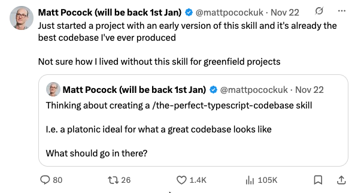

Text in the screenshot:

**@mattpocockuk · Nov 22**

> Just started a project with an early version of this skill and it's already the best codebase I've ever produced
>
> Not sure how I lived without this skill for greenfield projects

Quoting **@mattpocockuk · Nov 22**:

> Thinking about creating a /the-perfect-typescript-codebase skill
>
> I.e. a platonic ideal for what a great codebase looks like
>
> What should go in there?

80 replies · 26 reposts · 1.4K likes · 105K views

### anquetil

- https://x.com/anquetil/status/2122096419280695383/photo/1

### Steve Yegge

- https://x.com/Steve_Yegge/status/2121671447810888185

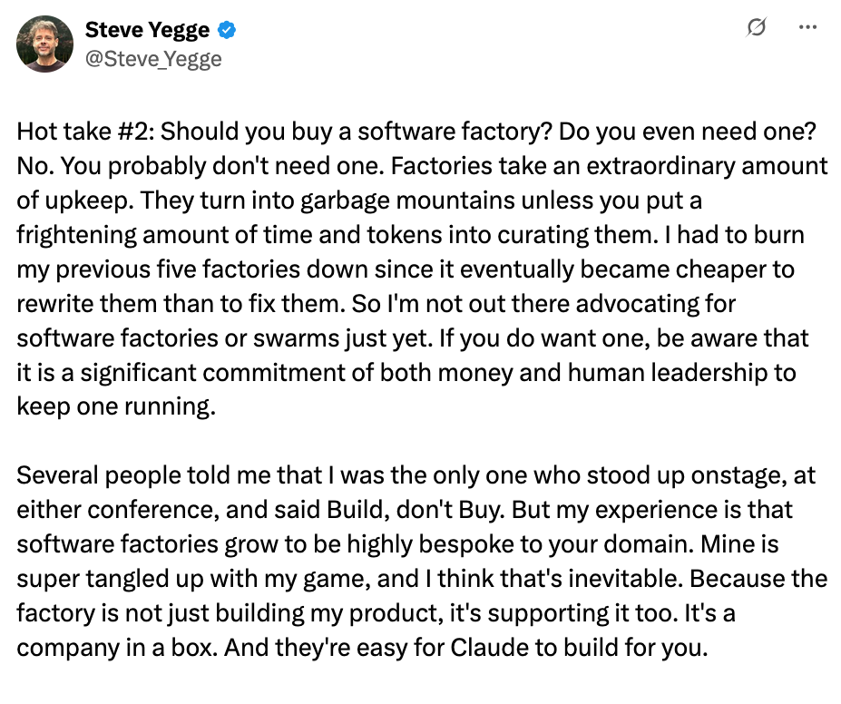

> LOL and this clown?
>
> this was gas town guy, the factory of factories

### Lauren Tan (@poteto) — talk

- https://www.youtube.com/watch?v=O_zcc6Xl12g

> this one is poteto's 11K PR video, "trust your agents"

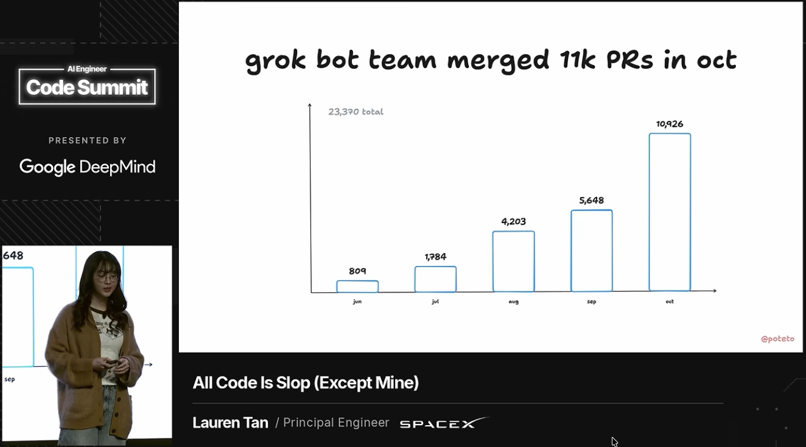

Text in the screenshot: AI Engineer Code Summit, presented by Google DeepMind · "All Code Is Slop (Except Mine)" · Lauren Tan / Principal Engineer · slide: "grok bot team merged 11k PRs in oct" · jun 809 · jul 1,784 · aug 4,203 · sep 5,648 · oct 10,926 · 23,370 total

> when I see this I wonder: what the hell you need to do on top of a clone of openclaw that requires 11K Pull Requests per month??????????

> is not a clone, the argument is a stretch... but I;ve been coding for several years, most complex systems I worked in had that amount of things merged in in years.
> The amount of features and the complexity of the systems was huge in comparison
> I mean, I know very few systems that run, work and are _useful_ that need that amount of changes.
>
> sooo... whats the deal PR porno?

> we cut a stable version release of the client once a day.
> LOL, looks like we call nightly builds stable now
> thats an industry change

> Potato says that the central issue with agents is trust. She says that we need to review proof of verifications. But the thing is, how can you trust a thing that it's inherently cheaty, that verifies itself? How can you trust those verifications? How do you know the same problems that are in the code are in the verification process itself? So the only way to just to verify the verification is to review the code. That's my take. And I would say in a team setting, trust is very, very subjective. I can trust my agent because I have a test suite and I see it written, and I have a few screenshots and they work, and I ask agent to, and I do a little bit of QA and it works. How can I trust that it respected the abstractions and the APIs that I built for them to use? Because usually it does not. So I think the central piece here is not trust, but value. In the world of slop, where's the value? I think that's the central thing we need to discover.

> wondering what the fuck they have added in the last 3 months in grok bot at 33K PRs

### Lauren Tan (@poteto) — pyramid

- https://x.com/poteto/status/2118613050462728659

> the re-discovery of architecture
>
> and the node analogy

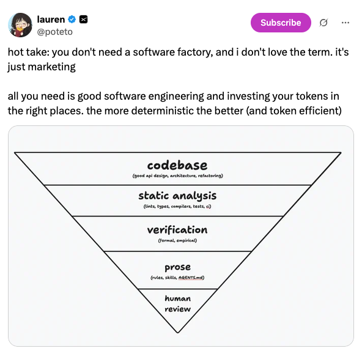

Text in the screenshot:

> hot take: you don't need a software factory, and i don't love the term. it's just marketing
>
> all you need is good software engineering and investing your tokens in the right places. the more deterministic the better (and token efficient)

Pyramid, top to bottom: codebase (good api design, architecture, refactoring) · static analysis (lints, types, compilers, tests, ci) · verification (formal, empirical) · prose (rules, skills, AGENTS.md) · human review

> LOL her pyramid contradict with her self. and we ALWAYS knew that architecture matters. architecture is code. so you need to read it

> no I mean, following the pyramid, .md skills and agents.md are a tiny piece 10x smaller compared to architecture approx?

### Lauren Tan (@poteto) — pstack

- https://github.com/cursor/plugins/tree/main/pstack

> she created pstack, do you know how many skills and lines of markdown it has?

Counted from the repo (last change Nov 19, 2026):

- 61 skills (`SKILL.md` files)
- 148 `.md` files
- 6,694 lines of markdown
- 73,561 words

### Dex Horthy

- https://www.youtube.com/watch?v=Ib5GBkD555M
- https://www.youtube.com/watch?v=ix1qQK1IvmA

> dex horthy and Mario zechner I think are the only people left with some undamaged brain tissue left in the industry right now. follow them. I don't think it'll last long but still  /s

### Dex Horthy — citing Eugene Yan (via swyx)

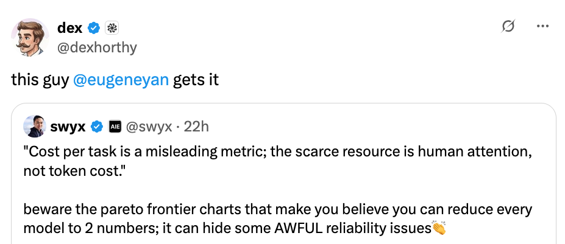

Text in the screenshot:

**dex (@dexhorthy) · 17h**

> this guy @eugeneyan gets it

Quoting **swyx (@swyx) · 20h**:

> "Cost per task is a misleading metric; the scarce resource is human attention, not token cost."
>
> beware the pareto frontier charts that make you believe you can reduce every model to 2 numbers; it can hide some AWFUL reliability issues 👏

> another from dex citing eugene yan. I think the observation is spot on.
> and something that can go in this section (factories don't work)

### David Cramer (@zeeg)

> @zeeg David Cramer from sentry. his more pilled than Mario or Dex I believe. still have some brain tissue too

### Mario Zechner — via Dex

- https://x.com/dexhorthy/status/2123162993550823688

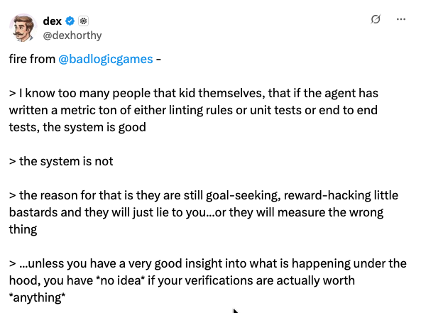

> Mario :chapeaux:

> I know too many people that kid themselves, that if the agent has written a metric ton of either linting rules or unit tests or end to end tests, the system is good
>
> the system is not
>
> the reason for that is they are still goal-seeking, reward-hacking little bastards and they will just lie to you...or they will measure the wrong thing
>
> ...unless you have a very good insight into what is happening under the hood, you have *no idea* if your verifications are actually worth *anything*

### Mario Zechner — talk

- https://www.youtube.com/watch?v=ZBTegd8DUZM&t=1306s

> I feel that we as an industry, what we are trying to do is to run away from understanding. And that doesn't make no fucking sense to me.... because if I don't have to understand anything anymore, what use are you for? why do I need to pay you? I just prompt my factory I don't need to pay you. I'll fire you

> the correct minute of that quoute is 34:00 (21:46 is hte previous one)

### Thorsten Ball

- https://x.com/thorstenball/status/2122922612770632070

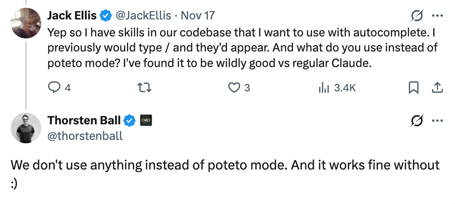

Text in the screenshot: Jack Ellis (@JackEllis) · Nov 17 · "Yep so I have skills in our codebase that I want to use with autocomplete. I previously would type / and they'd appear. And what do you use instead of poteto mode? I've found it to be wildly good vs regular Claude." · Thorsten Ball: "We don't use anything instead of poteto mode. And it works fine without :)"

> We don't use anything instead of poteto mode. And it works fine without :)
>
> I also personally think that invoking skills with slash customs is probably an anti-pattern:
>
> - you want the skill to be discoverable enough without a slash command
> - if it's a highly specific thing that's deterministically invoked, it makes me wonder why one uses the model as a workflow executor vs giving it a high-level goal and figuring it out
> - codebase should be self-explanatory and legible to the agent without deterministic invocation by human. If human has to tell agent when and how to review with highly specific skills, something probably went wrong somewhere else before

- https://x.com/thorstenball/status/2123125155568435654

> Very few engineers have imagination to come up with better tool. Instead of reviewing code in diffs, line by line, think: if I could wave a magic wand and make tooling disappear, what tooling would I want to gain confidence in this change being correct? Full instrumented/traced end-to-end runthrough? Demo videos? In-production probes? High-fidelity and anonymized production data fed through test runs? New testing environments with the greatest debugging MCP support one can imagine so agent can inspect everything?
>
> It's time to dream big.

https://x.com/thorstenball/status/2124743669781594564

> Benedict Evans on rethinking how you work with AI.
> Yes, he's talking about you all still using pull requests.

### Stephen Margheim — berlin.rb

- https://www.youtube.com/watch?v=OmrdvAzCSIc

> Something interesting from Steve Fenimore game, Fractal's Mind, on his talk in the Berlin Abbey user group. He says that it doesn't make sense anymore to apply changes like incrementally and leaving things for the future. That we are in a place now where we can do the things exactly that we want, the correct shape. The keys might switch to change the chip. So to apply changes atomically and completely. So if you came up with a new abstraction, instead of just setting the abstraction and using it in a single place and leave the old code that doesn't use the abstraction, refactor the whole code base. So the abstraction is the only thing that stays, and the whole code is always consistent and coherent. I think he's right.

> berlin.rb Stephen Margheim's

### Slack — #the-jules (yours)

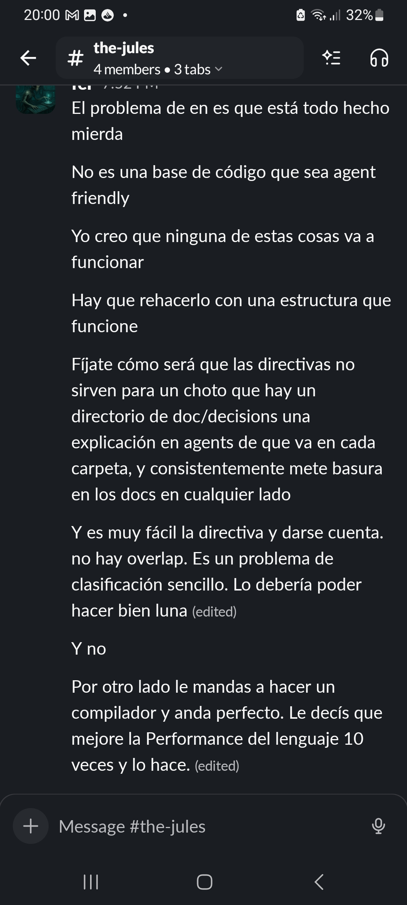

> El problema de en es que está todo hecho mierda
>
> No es una base de código que sea agent friendly
>
> Yo creo que ninguna de estas cosas va a funcionar
>
> Hay que rehacerlo con una estructura que funcione
>
> Fíjate cómo será que las directivas no sirven para un choto que hay un directorio de doc/decisions una explicación en agents de que va en cada carpeta, y consistentemente mete basura en los docs en cualquier lado
>
> Y es muy fácil la directiva y darse cuenta. no hay overlap. Es un problema de clasificación sencillo. Lo debería poder hacer bien luna
>
> Y no
>
> Por otro lado le mandas a hacer un compilador y anda perfecto. Le decís que mejore la Performance del lenguaje 10 veces y lo hace.

> Fui yo

### Slack — about PRs (yours)

> Lo vi. Le dije que me parecía que no iba por ahí la solución al code review
> [5:27 PM]O sea no es que hacer code Review está mal
> [5:28 PM]Pero no es la herramienta adecuada para lo que la estamos usando ahora
> [5:28 PM]Ni el modo
> [5:28 PM]Hasta te diría que los PRs son el problema
> [5:29 PM]Porque son code-oriented y ahora necesitamos algo idea/solution oriented
> [5:29 PM]Y la joda de tener un agente no ayuda por qué a la larga lo que yo quiero hacer es entender cómo pensaste tu solución que decisiones tomaste y porque
> [5:30 PM]Eso está en tu cabeza
> [5:30 PM]Las preguntas que yo le voy a hacer al agente en la mia
> [5:30 PM]O sea que no tiene sentido que ni vos ni yo le pidamos al agente que adivine que hay en la cabeza del otro
> [5:31 PM]La única forma es hablarlo creo
> [5:32 PM]El PR de agua estaba lleno de cosas raras
> [5:32 PM]Cuando le pregunto y termino de entender la solución las decisiones que había tomado estaban bien
> [5:33 PM]Pero el código no las hace evidentes
> [5:33 PM]Por el estilo de Claude o por lo que sea
> [5:33 PM]Me chupa un huevo en un punto lo lindo del codigo (edited)

> otro acerca de los prs

### Eric Clemmons (@ericclemmons) — ADRs

Images: `material/clemmons-adrs.png`, `material/clemmons-pocock-reply.png`

> one more 🤣

**@ericclemmons · Aug 25**

> ADRs solved my agent's codebase memory problem
>
> gist.github.com/ericclemmons/9...

**@ericclemmons · Nov 19**

> I was wrong. I deleted all ADRs from our codebase.
>
> 🔄 49% got superseded
> 3️⃣ days until superseded
> 🔜 7% were superseded that same day
>
> AI has made "leave it better than you found it" fiscally viable!
>
> Your codebase today is your ADR.
> Old patterns should be short-lived.

63 replies · 37 reposts · 474 likes · 92K views

**Matt Pocock (@mattpocockuk) · Nov 20, 2026**

> What was your criteria for creating ADR's?

**@ericclemmons · reply**

> 👋 I'll preface with you do it right 👑
>
> The root problem was the agent considered almost any high LoC change to be a "changed decision" and dutifully recorded it:
> > ... Write an ADR for a durable trade-off, contract, convention, rejected approach, or changed decision...
>
> (What we wanted were constraints to prevent old patterns)
>
> For those that still want ADRs, I point them to your skills & our Codex (blog.cloudflare.com/engineering-st...) with a very high bar:
>
> - HITL to record ADR
> - hard to reverse, surprising without context, AND a real-trade-off
> - MUST for security/compliance

Linked card: Cloudflare Blog — "How Cloudflare enforces engineering standards using AI"

> like this guy form cloudflare said one thing. 3 months later, says the opposite, when matt pocock challenges him, he says he does it right (use ADRs)
> 🤷 WTF

### Slack — about Code Reviews (yours)

> … un PR que tiene cosas raras y no se si es por que la feature es una mierda y no queda otra, si es porque hay una pila de decisiones que yo no estoy viendo desde el código, si son detalles qeu al autor se le pasó por alto, o si simplementes es lo que se le ocurrió a claude que era lo mejor y nadie le dijo nada.
> 4 escenario completamente diferentes que no puedo diferenciar.  No nos sirve.
>
> No quiero leer código, el código no me interesa el código en sí. Solo me interesa como medio para entender como es la solución, qué cosas probaron, que decisiones tomaron, sobre todo cómo cambia/extiende o afecta la arquitectura de la app.
>
> Hacer eso a partir del código cuesta un huevo.
> Básicamente tengo que resolver el problema yo en mi cabeza, pensar como lo implementaría,  entender como lo implementó la otra persona y laburar sobre el drift.  Antes era factible y había tiempo de hacer todo. Ahora creo que ya no.
> Para hacerlo  generalmente necesito mil idas y vueltas entre devs. Antes eran comments de github. Ahora son un perno.
> lentisimo, fuera de contexto. atrasan todo.
>
> El code review como lo venimos usando (de la misma forma que siempre) no funca.
>
> A una feature implementada (no me importa como, si claude, si a mano si gpt, es anecdótico a esta altura), testeada, aprobada por producto, ya es muy tarde para andar mirando el código.
>
> Sobre todo por que la función del code review no es mas la que tenía.
>
> El código no lo tengo que mirar yo, lo tienen que mirar quien hace el PR.
>
> Qué buscamos? cosas raras. Porque son indicios de que el agente está desvariando y que hay una decision que no se tomó.
> o que algo en la solución está mal pensado
> o que nos falta un skill / guideline
>
> La revisión de que lo que el agente hizo respeta los lineamientos de la app, eso no se revisa en code review tampoco. es muy tarde. no tiene sentido que yo tenga uqe agarrar mi agente y decirle “fijate que en esta branch no haya instancias de este guideline roto”. todos esos checkeos lo tiene que hacer quien esté trabajando con le código.
>
> lo mismo con los tests (sirven?, no sirven?, testean lo que tienen que testear? están repetidos? de mas?)
>
> Todo el laburo sobre el código es parte de la implementación.
>
> TLDR:
>
> antes de arrancar a promptear, piensen la solución, definan la arquitectura (esto lo hacen con el agente, en un papel, cantando en el baño, me da lo mismo). PAra esto puedejn hacer 18 prorotipos, no hay que imaginarse mas las cosas, las podes ver andando, que es una validación instantanea de que la idea que tuviste funciona o no. Elijan lo que mas le convenza. anoten por que.
> acá va el review
> implementen lo acordado (de nuevo, con agente, con mil agentes, sin agente, me da lo mismo). y de nuevo, podes hacer que genere el código 18 veces. con cada implementación checkeen TODO y busquen qué nos falta, indaguen por qué el agente genera las cosas “mal”. (esto es code review). de nuevo anoten por qué eligieron lo que eligieron
> Pull Request: acá podríamos solicitar un segundo par de ojos, a nivel super general. pero consideren todo lo que esta persona tendría que hacer para ponerse up-to-speed con todo el laburo hecho… sigue teniendo sentido?? yo creo que lo único que se podría revisar acá son las ultimas decisiones tomadas (porque elegiste el código este). No se si el PR es el lugar para hacerlo

### Blasteroids (yours)

File: `blasteroids.html` (Downloads)

> this is to show off the engine and language I vibecoded in less than a week

### Scott Werner — Nobody Knows How To Build With AI Yet

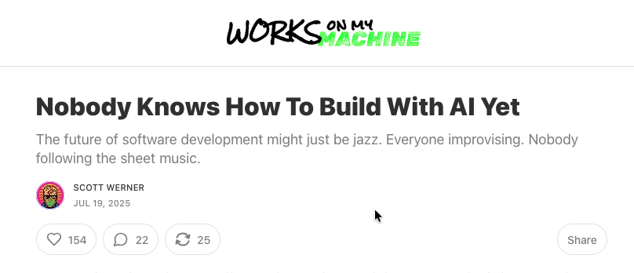

Text in the screenshot: Works on my Machine · "Nobody Knows How To Build With AI Yet" · The future of software development might just be jazz. Everyone improvising. Nobody following the sheet music. · Scott Werner · Jul 19, 2025

> this is for nobody knows nothing section.
>
> This section will be an intro, telling a little bit about what we did before, what I did before with AI and things. So this was one of the slides on a talk I gave 1 year ago, and I think it still applies. So the idea in this section is show the title, next slide, this screenshot, and then explain a little bit what we did, do a quick summary of that talk. That talk talks about the agentic trifecta: a triangle that represents  the balance between the model, the agent/harness, and the workflow (how we use it). And I think that model still applies. And probably I'll use it afterwards. A few times. I think that will be it for the content of that section.
>
> I think I mentioned this earlier, but also uh, it works as a disclaimer. Nobody knows nothing excludes me too. So then, so that would be the opening of the next section. That would be the critical stance. To have critical stance.
>
> brain tissue could be the next section. add it between 1 and 2

### Slack — sol, extra high (yours)

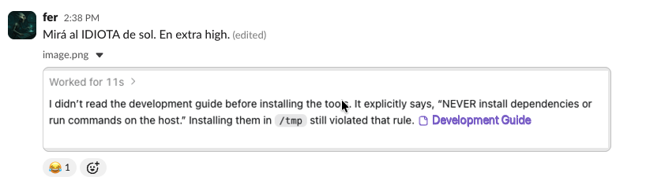

Text in the screenshot: fer 2:38 PM · Mirá al IDIOTA de sol. En extra high. (edited) · image.png · Worked for 11s · I didn't read the development guide before installing the tools. It explicitly says, "NEVER install dependencies or run commands on the host." Installing them in `/tmp` still violated that rule. · Development Guide

> This is for the trust section.  after the PR porn.
>
> how can you trust this writing your code to production? it cannot follow a VERY simple guideline.
>
> this is signal that Reinforcement Learned things beat prose every single time.
> which means skills doesn't work.
>
> also mean that the only thing you an be 100% sure is that they will fuck with you, cheatty little bastards
>
> So, the question is "how do we take profit from a thing that is always sneaking around to miss behave"?

### Meme — "Do you really expect me to read..." (image)

Image: man at a desk holding a book titled "All That Shit! By You", caption "Do you really expect me to read..". Cropped: the top caption line (racial slur) removed. Original: `material/meme-expect-me-to-read.webp`.

### PR — code review stamp (yours)

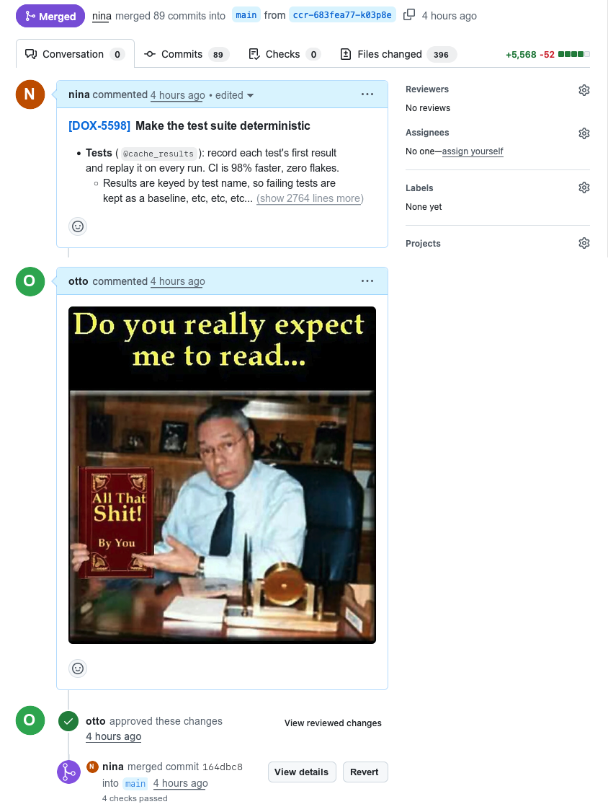

Assembled from your PR screenshots: description comment → meme comment → approve → merge. Changed: 89 commits, 396 files changed, fake names and avatars (nina: author and merger; otto: meme and approve).

> wait better. lets use it as the code review stamp

## coprolito

- Slide: "coprolito" / "a jewel made of shit", background `material/coprolito.png` (generated)
- Notes:
  - historia de coprolito
  - cómo reconciliamos las ideas slop

## Thorsten Ball — "It's November 2026" (screenshot)

- `material/thorsten-november-theater.png`
- Link: https://x.com/thorstenball/status/2126006279176921404
- "It's November 2026. How you used agents 3 months ago might now be theater." + screenshot of "How to Not Use Agents in November '26" (starts: "Review code before the agent even ran it and tested it…")
